# FieldSight Edge

[](https://github.com/HUSNAIN-MUNAWAR/fieldsight-edge/actions/workflows/ci.yml)
[](LICENSE)
[](apps/api/requirements.txt)
[](apps/web/package.json)
[](apps/api/requirements.txt)
[](docker-compose.yml)
[](https://github.com/HUSNAIN-MUNAWAR/fieldsight-edge)

> **Evidence-first industrial AI operations—from field capture to human-verified maintenance action.**

FieldSight Edge is a runnable, multi-tenant industrial visual-inspection reference platform for solar farms, infrastructure corridors, facilities, roofs, construction sites, and asset-heavy field operations. It is deliberately **not** a model-upload demo: it connects capture, local edge queueing, deterministic inference, human review, asset risk, alerts, maintenance workflows, reporting, model-governance records, and audit trails.

> **Demo integrity:** All organizations, imagery, coordinates, assets, model outputs, scores, reports, metrics, alerts, and maintenance records are synthetic. FieldSight Edge does **not** claim real inspection accuracy, predictive-maintenance accuracy, real drone deployment, FAA approval, customer usage, SOC 2/ISO certification, live CMMS/ERP/GIS integration, or live physical device model deployment.

## At a glance

- **Product scope:** Industrial visual-inspection operations for evidence capture, review, defect management, and reporting.
- **Primary users:** Operations leaders, reviewers, field teams, maintenance coordinators, and ML/platform engineers.
- **Best demo path:** Run the FastAPI service locally, start the Next.js console, then exercise the seeded workspace plus the edge-agent CLI.
- **Local runtime goal:** Credible CPU-first demo mode with durable synthetic records and zero external paid dependencies.

## Why FieldSight Edge exists

Computer vision becomes operationally useful only when teams can prove where evidence came from, decide whether it is trustworthy, assign work, verify resolution, and retain the decision history. FieldSight Edge demonstrates those controls in a CPU-first local environment while documenting the production boundaries required for deployment.

## Core capabilities

- **API-driven control plane:** Next.js routes load tenant-scoped FastAPI data through a typed client and TanStack Query cache keys; significant mutations invalidate related workspace queries.
- **Persistent multi-tenant workflows:** SQLAlchemy records, Alembic revisions, idempotent seed data, organization boundaries, role gates, audit events, and SQLite local fallback.
- **Field operations:** Mission planning, device assignment, offline-capable edge-agent simulation, capture queue, retry-safe synchronization, media validation, and capture quality context.
- **Evidence-first AI:** Deterministic local inference (default), durable inference jobs, confidence-gated review, original detector output preservation, human decision records, verified defects, and evidence lineage.
- **Geospatial operations:** Live command-map data for sites, boundaries, assets, findings, risk, coverage, device state, and fallback coordinate/bounding-box filters. PostGIS is a documented production boundary.
- **Maintenance execution:** Approval-gated work-order lifecycle, assignee updates, resolution-evidence controls, verification before closure, and audit history.
- **Model & dataset governance:** Candidate models, synthetic evaluation records, dataset-candidate flow, staged deployment approval, rollback simulation, and explicit adapter boundaries.
- **Trust & governance:** Data-quality notices, alert and watchlist persistence, report schedules, scoped API-key records, deletion-request workflow, request IDs, headers, and observability health endpoint.

## Technology stack

| Layer | Tools |
| --- | --- |
| Web console | Next.js 15, React 19, TanStack Query, TypeScript, Playwright |
| API | FastAPI, SQLAlchemy, Alembic, Pydantic, ReportLab |
| Quality gates | ESLint, TypeScript, Ruff, Pytest |
| Local runtime | SQLite, local filesystem storage, deterministic inference provider |
| Deployment boundary | Docker Compose, PostgreSQL, Redis, S3-compatible storage, optional worker |
| Edge simulation | Python CLI for offline queueing, synchronization, and deterministic findings |

## Screenshots

The images below were captured on **July 8, 2026** from the locally running application and stored under [`docs/screenshots/`](docs/screenshots/). The capture flow uses a real browser against the live seeded API and web console:

```bash
npm --prefix apps/web run capture:screens
```

| Mission control | Command map |
| --- | --- |
| 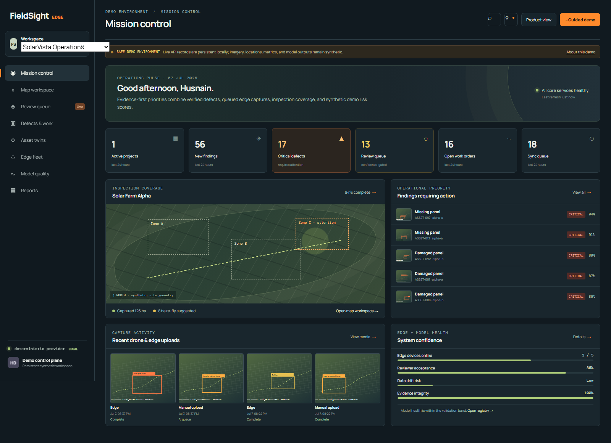 | 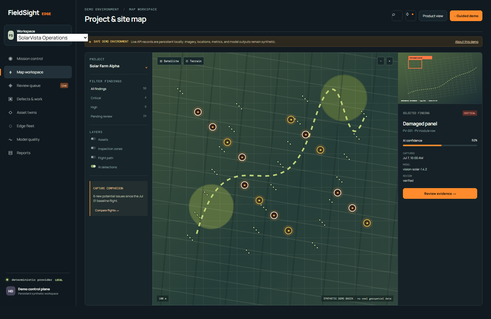 |
| Review workspace | Defects and work orders |
| 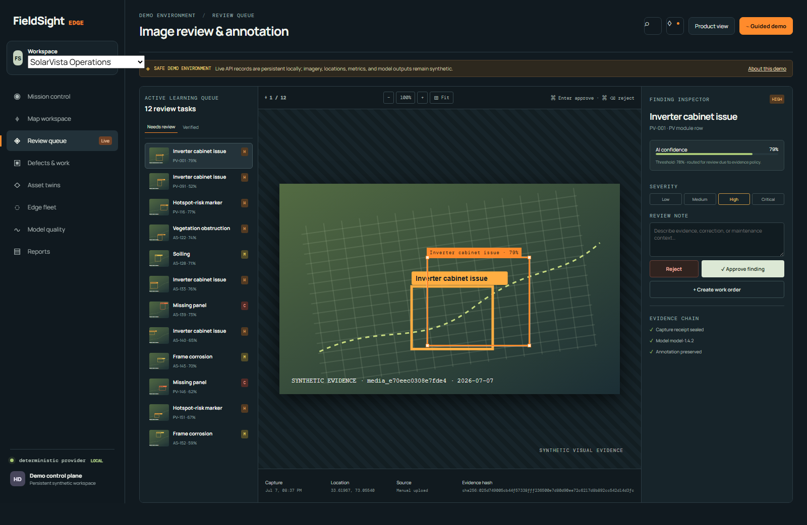 | 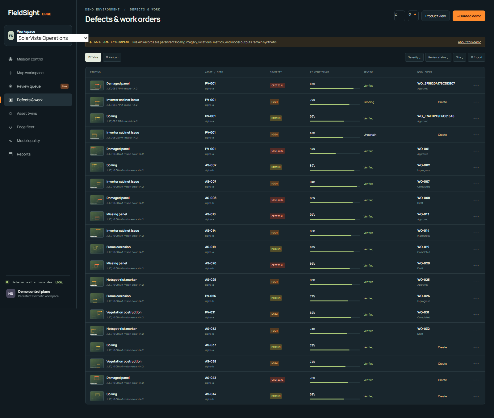 |
| Edge fleet | Operations console |
| 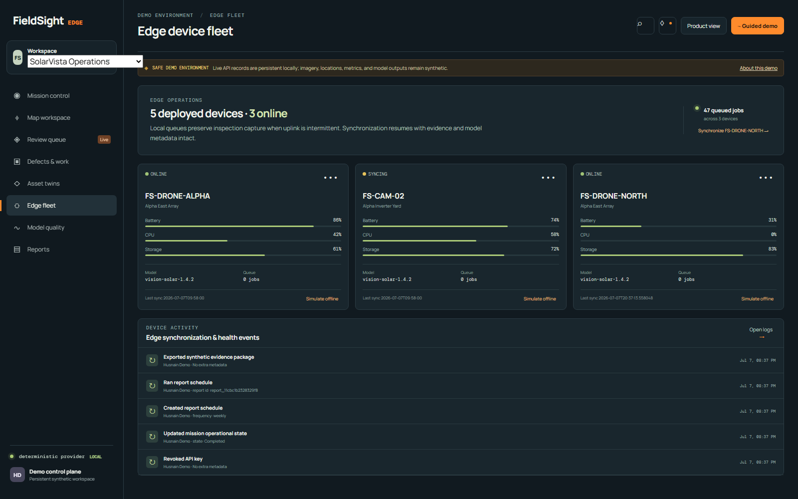 | 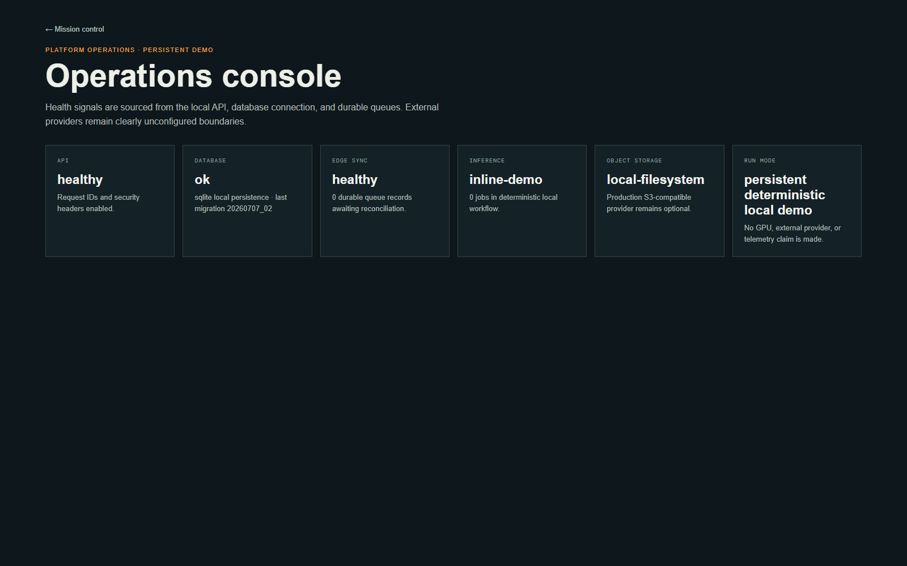 |

Additional captures:

- [`docs/screenshots/01-landing-page.png`](docs/screenshots/01-landing-page.png)
- [`docs/screenshots/05-media-intake.png`](docs/screenshots/05-media-intake.png)
- [`docs/screenshots/10-model-governance.png`](docs/screenshots/10-model-governance.png)
- [`docs/screenshots/11-reporting.png`](docs/screenshots/11-reporting.png)
- [`docs/screenshots/15-mobile-field-operator.png`](docs/screenshots/15-mobile-field-operator.png)
- [`docs/screenshots/16-api-docs.png`](docs/screenshots/16-api-docs.png)

All screenshots are clearly synthetic demo data and are never presented as customer or live industrial evidence.

### Measured local runtime evidence

Run the real auth, offline queue, sync, deterministic inference, and report path:

```bash
make runtime-evidence
```

The command writes an API trace, CSV, MP4 state animation, poster, PDF report,
and hash-addressed summary under [`docs/runtime_evidence/`](docs/runtime_evidence/).
The evidence remains explicitly bounded to SQLite, synthetic capture bytes, and
the local deterministic provider; it is not a physical camera or production
model-accuracy claim.

## Quick start

1. Start the API in deterministic local mode and seed the demo workspace.
2. Start the web console in development mode for iteration, or use the production build plus `npm run start` for release parity.
3. Sign in with a demo account from the table below.
4. Run the edge-agent CLI or Playwright capture flow to exercise the strongest operational paths.

## Demo accounts

All accounts use `DemoPass123!`.

| Role | Account | Workspace |
| --- | --- | --- |
| Organization Admin | `admin@fieldsight.demo` | SolarVista, Atlas, Meridian |
| Reviewer | `reviewer@solarvista.demo` | SolarVista Operations |
| Field Operator | `operator@atlas.demo` | Atlas Infrastructure Services |
| Maintenance Coordinator | `maintenance@meridian.demo` | Meridian Facilities Group |
| Data Scientist | `scientist@solarvista.demo` | SolarVista Operations |

## Local deterministic mode

The standard local path works without GPU hardware, drone hardware, Docker, model weights, ONNX/Ultralytics downloads, cloud accounts, paid APIs, S3, Redis, CMMS/ERP/GIS credentials, Slack, email, weather providers, or real telemetry devices.

- **Inference:** deterministic provider only; output is synthetic but durable and reviewable.
- **Storage:** local filesystem abstraction.
- **Database:** SQLite local fallback.
- **Edge:** persisted local queue and sync simulation.
- **Reporting:** locally generated PDF.
- **Model releases:** governed control-plane simulation, never a claim that a physical device binary was updated.

## Configuration

Copy [`.env.example`](.env.example) and adapt only the values you need for your local or production-like run.

| Variable | Purpose | Local default |
| --- | --- | --- |
| `NEXT_PUBLIC_API_URL` | Web console base URL for the API | `http://localhost:8000` |
| `FIELDSIGHT_ENV` | Runtime mode guardrails | `development` |
| `DATABASE_URL` | SQLAlchemy connection string | PostgreSQL example in `.env.example`; SQLite works without setting this in local demo mode |
| `REDIS_URL` | Worker / queue boundary for Docker or production-like setups | `redis://localhost:6379/0` |
| `FIELDSIGHT_DEMO_MODE` | Enables deterministic local demo protections | `true` |
| `FIELDSIGHT_TRUSTED_ORIGINS` | Allowed browser origins for production mode | `http://localhost:3000,http://127.0.0.1:3000` |
| `FIELDSIGHT_APP_SECRET` | Application secret required for production mode | `replace-before-production` |
| `FIELDSIGHT_WORKER_MODE` | Worker execution mode | `inline` |

## System architecture

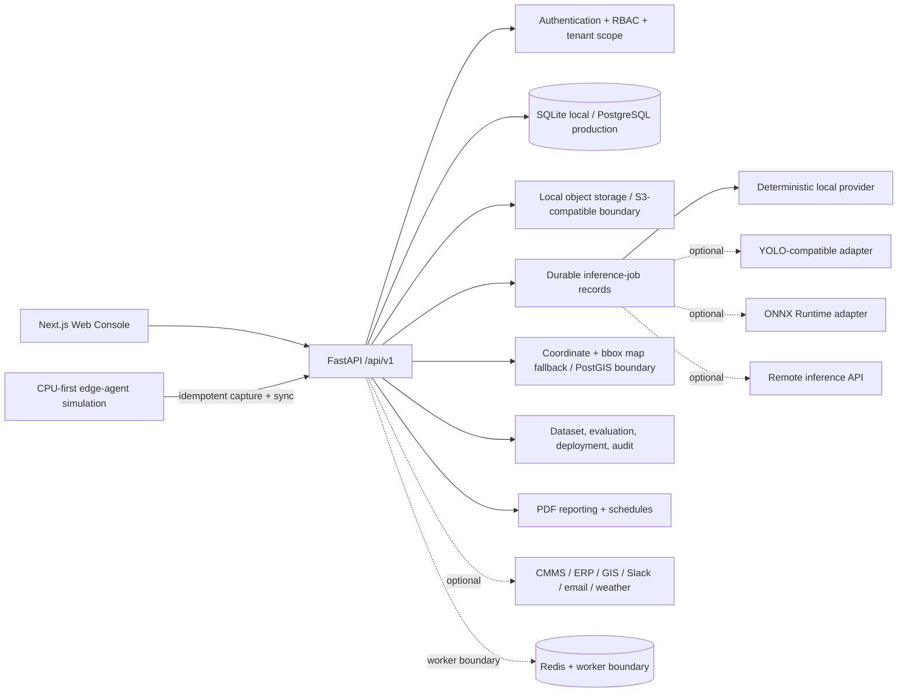

## Field-to-cloud lifecycle

```mermaid
flowchart LR
  Plan[Mission plan] --> Field[Field operator]
  Field --> Capture[Device capture]
  Capture --> Queue[Offline queue]
  Queue --> Sync[Sync + validation]
  Sync --> Inference[Inference job]
  Inference --> Finding[AI finding]
  Finding --> Review[Human review]
  Review --> Defect[Verified defect]
  Defect --> Risk[Asset-risk snapshot]
  Risk --> Alert[Alert]
  Alert --> Work[Work-order draft]
  Work --> Approval[Approval]
  Approval --> Resolve[Resolution evidence]
  Resolve --> Verify[Verification inspection / review]
  Verify --> Report[Report]
  Report --> Audit[Audit trail]
```

## Edge-sync state machine

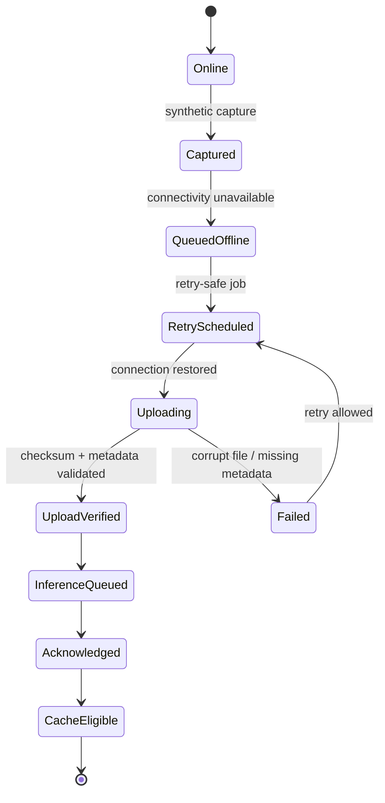

## Inference lifecycle

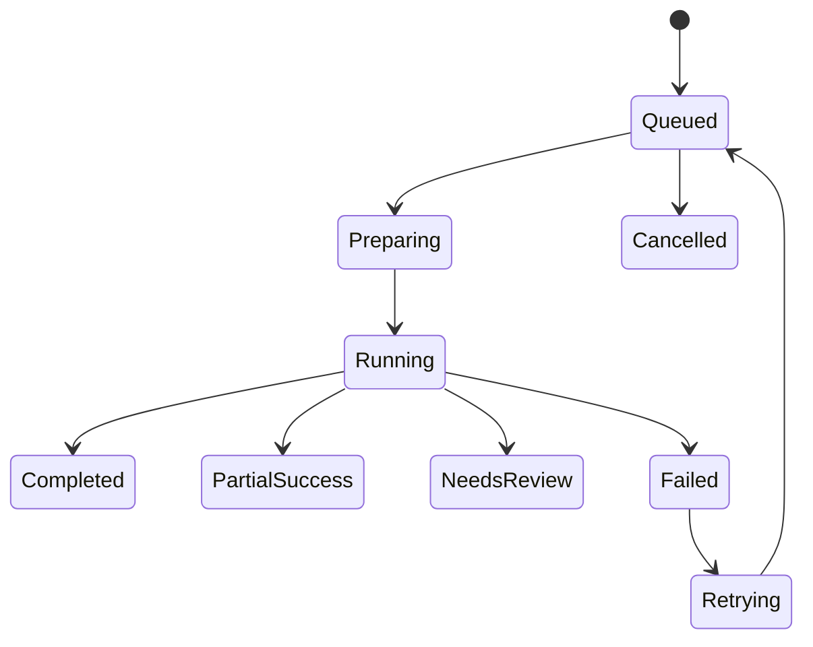

## Evidence lineage

```mermaid
flowchart LR
  Media[Original media] --> Capture[Capture session]
  Capture --> Device[Device / operator]
  Device --> Mission[Mission]
  Mission --> Validate[Validation]
  Validate --> Job[Inference job]
  Job --> Model[Model version]
  Model --> Finding[Finding]
  Finding --> Decision[Reviewer decision]
  Decision --> Defect[Verified defect]
  Defect --> Work[Work order]
  Work --> Evidence[Resolution evidence]
  Evidence --> Report[Report]
  Report --> Audit[Audit event]
```

## Finding-to-work-order workflow

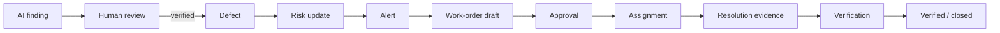

## Change intelligence

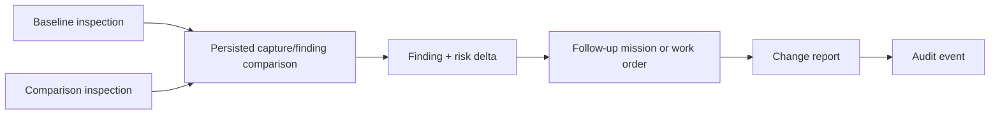

## Model governance and release

```mermaid
flowchart LR
  Candidate[Dataset candidate] --> Dataset[Dataset version]
  Dataset --> Model[Candidate model]
  Model --> Eval[Synthetic evaluation record]
  Eval --> Gate[Quality gate]
  Gate --> Review[Inspection manager review]
  Review --> Approval[Organization-admin approval]
  Approval --> Stage[Staged deployment simulation]
  Stage --> Monitor[Control-plane monitoring]
  Monitor --> Rollback[Rollback simulation]
```

## Multi-tenant authorization flow

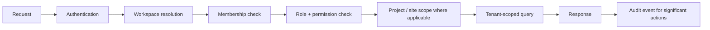

## Reporting workflow

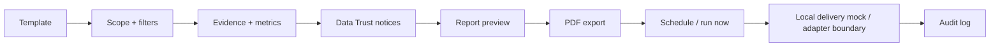

## API and integration boundary

The primary API is `/api/v1/`. It has documented resource areas for auth, workspaces, projects, missions, media, inference, findings, work orders, devices, models, datasets, alerts, reports, governance, search, and operational health. Significant writes add audit events; request IDs are exposed in response headers.

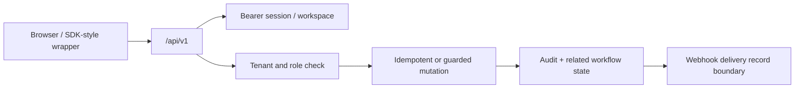

See [`docs/api-guide.md`](docs/api-guide.md), [`docs/sdk-guide.md`](docs/sdk-guide.md), and [`docs/webhooks.md`](docs/webhooks.md).

## Run locally

### 1. API — SQLite deterministic mode

```bash
cd apps/api
python -m venv .venv
source .venv/bin/activate  # Windows: .venv\Scripts\activate
pip install -r requirements.txt

PYTHONPATH=. alembic upgrade head
PYTHONPATH=. python scripts/seed_demo.py
uvicorn app.main:app --reload --port 8000
```

Useful API pages:

- `http://localhost:8000/docs` — OpenAPI documentation
- `http://localhost:8000/health` — runtime health
- `http://localhost:8000/api/v1/operations/health` — platform operations health

### 2. Web console

```bash
cd apps/web
npm ci
npm run dev

# production-parity local run
npm run build
npm run start
```

Open `http://localhost:3000`.

`npm run start` copies the standalone static assets into the local runtime bundle before launching the production server, mirroring the Docker deployment layout.

Key routes:

- `/map` — live geospatial command map
- `/missions` — mission operations
- `/media` — media validation and evidence lineage
- `/review` — review queue and annotation workspace
- `/risk` — explainable asset risk
- `/defects` — maintenance planning and work orders
- `/devices` — edge fleet operations
- `/models` — model and dataset governance
- `/quality` — inspection data quality
- `/alerts` — alerts and watchlists
- `/reports` — reporting center
- `/security` — security and governance
- `/operations` — platform operations console
- `/search` — tenant-scoped global search
- `/login` — demo login route
- `/design-system` — internal UI pattern reference

### 3. PostgreSQL workflow

Set `DATABASE_URL` to PostgreSQL and run Alembic before starting the API. `FIELDSIGHT_ENV=production` enforces PostgreSQL, non-demo configuration, trusted origins, and a non-demo secret.

```bash
export DATABASE_URL='postgresql+psycopg://...'
export FIELDSIGHT_ENV=production
export FIELDSIGHT_DEMO_MODE=false
export FIELDSIGHT_APP_SECRET='replace-with-managed-secret'
export FIELDSIGHT_TRUSTED_ORIGINS='https://console.example.com'
PYTHONPATH=. alembic upgrade head
uvicorn app.main:app --host 0.0.0.0 --port 8000
```

### 4. Edge-agent simulation

```bash
cd apps/edge-agent
python agent.py run-demo-mission --device edge-03 --count 4
python agent.py simulate-failure --device edge-03 --failure corrupt-file
python agent.py queue-status --device edge-03
python agent.py sync-now --device edge-03
```

The simulator creates persisted queue and sync records. It does not control a drone or ingest device telemetry.

## CLI usage examples

```bash
cd apps/edge-agent
python agent.py --help
python agent.py run-demo-mission --device edge-03 --count 2 --api http://127.0.0.1:8000
python agent.py queue-status --device edge-03 --api http://127.0.0.1:8000
```

## API usage examples

```bash
curl http://127.0.0.1:8000/health

curl -X POST http://127.0.0.1:8000/api/v1/auth/login \
  -H "Content-Type: application/json" \
  -d '{"email":"admin@fieldsight.demo","password":"DemoPass123!"}'
```

### 5. Docker boundary

```bash
docker compose up --build
```

Compose supplies PostgreSQL and Redis service boundaries. The final verification record states whether Docker was executable in the build environment.

## Testing

```bash
cd apps/api
PYTHONPATH=. pytest -q
PYTHONPATH=. ruff check .

cd ../web
npm run lint
npm run typecheck
npm run build
npm run test:e2e
npm run capture:screens
```

Migration verification:

```bash
cd apps/api
DATABASE_URL="sqlite:///$(pwd)/.data/fresh.db" PYTHONPATH=. alembic upgrade head
DATABASE_URL="sqlite:///$(pwd)/.data/fresh.db" PYTHONPATH=. python scripts/seed_demo.py
DATABASE_URL="sqlite:///$(pwd)/.data/fresh.db" PYTHONPATH=. python scripts/migration_status.py
```

## Repository structure

```text
fieldsight-edge/
├── apps/
│   ├── api/
│   │   ├── app/                  # FastAPI, SQLAlchemy, services, security, client wrapper
│   │   ├── app/alembic/          # explicit Phase 2 and Phase 3 revisions
│   │   ├── tests/                # workflow, tenant, and API tests
│   │   └── scripts/              # idempotent seed + migration status
│   ├── edge-agent/               # CPU-first persisted queue/sync simulator
│   └── web/                      # Next.js console, typed API client, TanStack Query provider
├── docs/                          # architecture, operations, deployment, security, boundaries
│   └── screenshots/               # real browser captures from the local seeded demo
├── examples/                      # local integration examples
├── screenshots/                   # preserved baseline captures
└── docker-compose.yml
```

## Security posture

FieldSight Edge implements **security controls designed to support enterprise deployment**: password hashing, session tracking, token revocation, organization-scoped queries, role gates, request IDs, security headers, MIME/size/checksum media validation, audit events, API-key records, deletion-request records, and explicit production environment checks.

This portfolio repository is not a compliance-certified service and does not claim SOC 2, ISO, HIPAA, FAA, or industry certification.

## Honest limitations

- Local deterministic inference is a rules-based synthetic provider; it does not prove real model accuracy.
- Geospatial local mode uses coordinates and bounding-box filtering. PostGIS, map tiles, clustering, and spatial indexing are production integration work.
- The worker, Redis, object storage, CMMS/ERP/GIS, email, Slack, weather, YOLO/ONNX, and remote-inference integrations are documented boundaries or optional adapters, not configured live services.
- Staged model deployment and rollback are persistent control-plane simulations; no physical device binary changes occur.
- The default local database is SQLite. Use PostgreSQL, PostGIS, Redis, managed object storage, secrets, backups, and monitored workers for deployment.
- Browser screenshot and Playwright execution depend on installed browser binaries and sandbox policy. See the verification record instead of assuming a route was browser-tested.

## Roadmap

1. Add PostGIS-backed spatial indexes and real tile-provider configuration.
2. Add signed external webhook delivery with retry workers and dead-letter handling.
3. Wire optional YOLO/ONNX/remote providers behind credentialed deployments.
4. Add real object-storage multipart uploads and device provisioning.
5. Add managed identity, secrets rotation, centralized logs, metrics, tracing, backups, and retention automation.

## Contributing

Start with [CONTRIBUTING.md](CONTRIBUTING.md), then read [`docs/testing.md`](docs/testing.md), [`docs/database-migrations.md`](docs/database-migrations.md), and [`docs/system-boundaries.md`](docs/system-boundaries.md). Contributions should preserve deterministic local mode, write tenant-scoped tests, avoid fake deployment claims, and document new optional providers explicitly.

## License

FieldSight Edge is released under the [MIT License](LICENSE).
